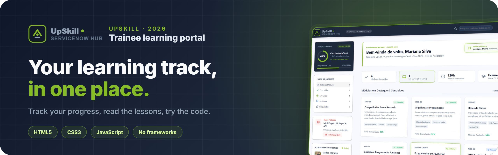
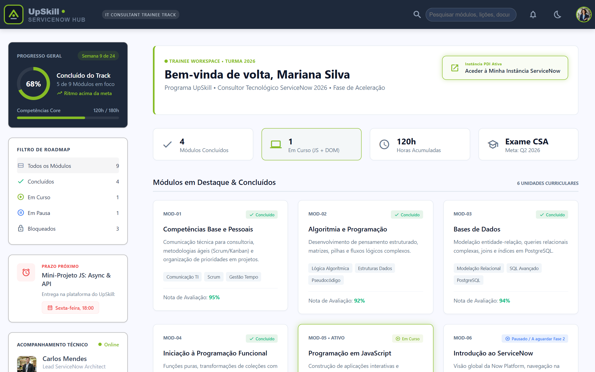
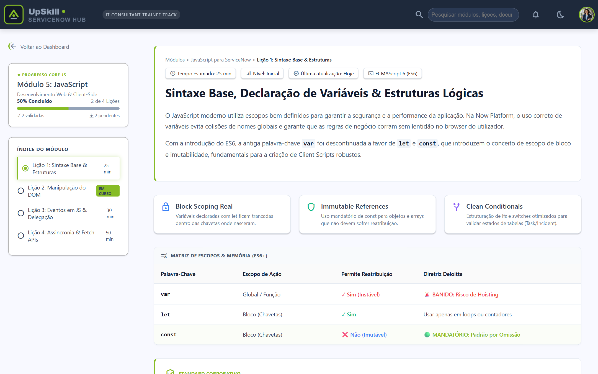
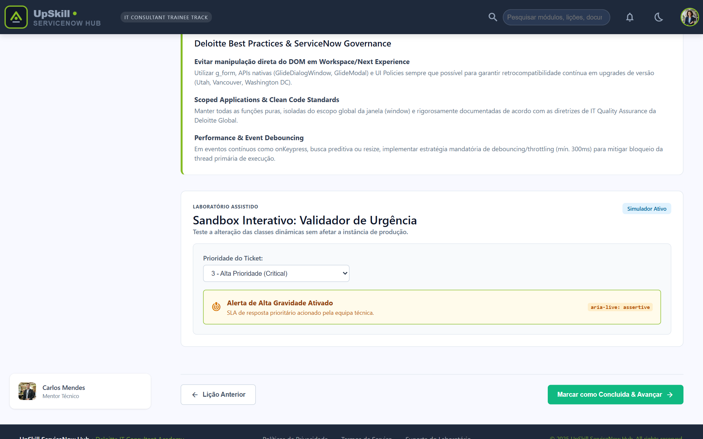
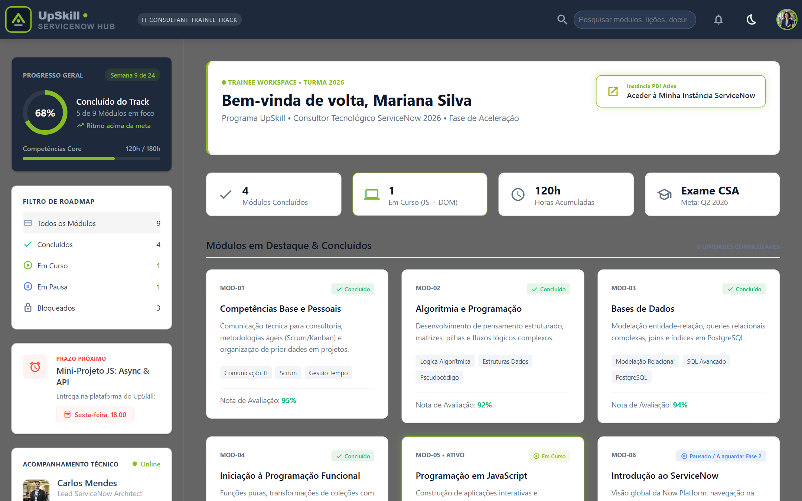
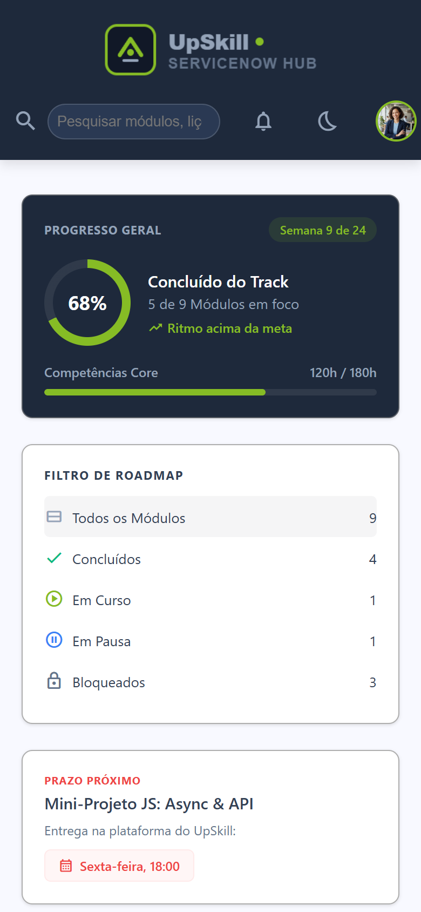

<div align="center">



<br>

<a href="https://pauloduarteoliveira.github.io/UpSkill-ServiceNow-Hub/"></a> <a href="#-screenshots"></a> <a href="#-run-it-locally"></a>

<br><br>


</div>

<br>

> **A learning portal for ServiceNow trainees.** Follow your progress through the track, read the lessons, and try the code in a built-in sandbox, all in hand-written HTML, CSS and JavaScript.

Built as the practice project for the **JavaScript Programming** module of the **UPskill ServiceNow** programme (2026 class): the goal was to put the HTML5, CSS3 and JavaScript fundamentals together in something that looks and works like a real company tool.

## 📸 Screenshots

<p align="center">
  
  <br><sub><b>Dashboard.</b> Overall progress, summary cards, featured modules and the roadmap.</sub>
</p>

<table>
  <tr>
    <td width="50%"><br><sub><b>Lesson 1.</b> Syntax, variables and a <code>var</code> / <code>let</code> / <code>const</code> comparison.</sub></td>
    <td width="50%"><br><sub><b>Lesson 2.</b> The DOM, Client Scripts and the urgency validator sandbox.</sub></td>
  </tr>
  <tr>
    <td><br><sub><b>Dark mode.</b> One tap on the moon icon.</sub></td>
    <td align="center"><br><sub><b>On a phone.</b> The layout stacks into one column.</sub></td>
  </tr>
</table>

## ✨ Highlights

<table>
  <tr>
    <td width="33%" valign="top">
      <h3>🏠 Dashboard</h3>
      Progress ring, summary cards, featured and completed modules, and what's next on the roadmap.
    </td>
    <td width="33%" valign="top">
      <h3>📘 Lessons</h3>
      Two lessons on JavaScript for ServiceNow: the basics (variables, scope, logic) and the DOM with Client Scripts (<code>g_form</code>).
    </td>
    <td width="33%" valign="top">
      <h3>🧪 Sandbox</h3>
      Pick a ticket priority and watch the page react: a small, safe place to try dynamic classes.
    </td>
  </tr>
  <tr>
    <td valign="top">
      <h3>🌙 Dark mode</h3>
      The whole workspace switches colours with a single <code>classList.toggle</code>.
    </td>
    <td valign="top">
      <h3>👤 CSS-only menu</h3>
      The profile dropdown opens by click or keyboard with <code>:focus-within</code>, with no JavaScript.
    </td>
    <td valign="top">
      <h3>🧭 Smart cards</h3>
      One card, two destinations: the module or straight to the current lesson, using layered links and <code>z-index</code>.
    </td>
  </tr>
</table>

## 🛠 How it's built

| Part | How |
|---|---|
| 🧱 **Structure** | Semantic HTML5: `<header>`, `<aside>`, `<main>`, `<article>`, `<footer>` |
| 🎨 **Theme** | CSS variables in `:root` for the whole palette: lime `#86BC25` on slate `#0F172A` |
| 📐 **Layout** | CSS Grid for the page (fixed 280px sidebar + flexible workspace) and the auto-fitting card grids; Flexbox for headers, buttons and summary cards |
| 📱 **Responsive** | Media queries reflow everything for tablets and phones |
| ✂️ **Clean styles** | One shared `style.css`, no inline styles |
| ⚡ **JavaScript** | Plain JavaScript, only where it's needed: dark mode and the sandbox |

<details>
<summary><b>🐙 How the work was organised with Git</b></summary>
<br>

- **Feature branches:** `main` always held a working version; each part (header, sidebar, each lesson) was built on its own branch, like `feature/homepage-layout` or `feature/licao1-matriz`.
- **Conventional Commits:** short, clear messages with prefixes such as `feat:`, `fix:` and `style:`.
- **Checked before merging:** every change was tested with Live Server at different screen sizes before it reached `main`.

</details>

## 🚀 Run it locally

```bash
git clone https://github.com/PauloDuarteOliveira/UpSkill-ServiceNow-Hub.git
```

Open the folder in **VS Code**, right-click `index.html` → **Open with Live Server**. Or simply open `index.html` in your browser.

## 📁 Project structure

```
UpSkill-ServiceNow-Hub/
├── index.html              → Dashboard
├── js-modulo-licao1.html   → Lesson 1: syntax, variables and logic
├── js-modulo-licao2.html   → Lesson 2: the DOM, Client Scripts and the sandbox
├── style.css               → All the styles
├── assets/                 → Logo and profile pictures
├── referencias/            → Design references (Google Stitch)
└── docs/                   → README banner and screenshots
```

## 🎨 Design

The layout was based on a dashboard designed with **Google Stitch**; the reference images are in [`referencias`](referencias).

<br>

<div align="center">
  
  <br>
  <sub>Made for the UPskill ServiceNow programme by <a href="https://github.com/PauloDuarteOliveira"><b>Paulo Duarte Oliveira</b></a> · 2026</sub>
</div>
